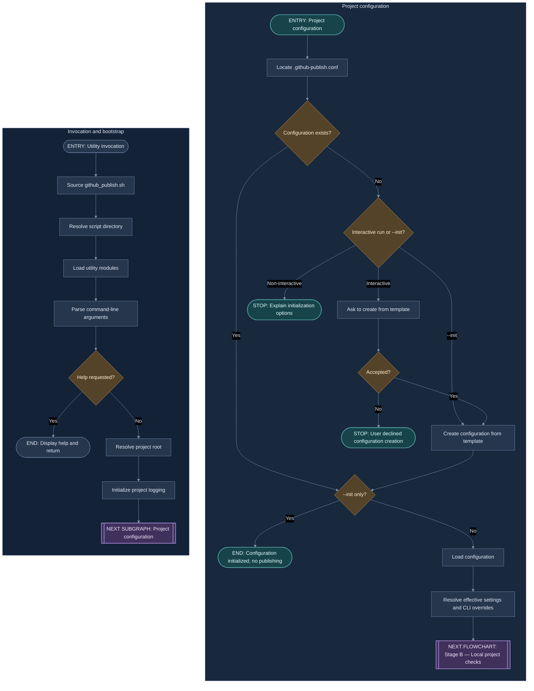
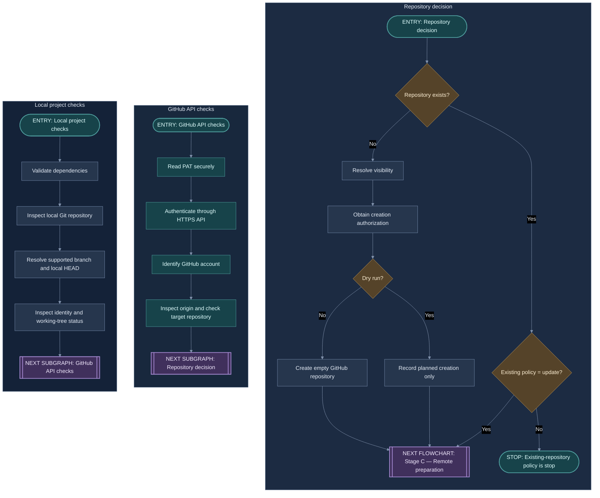
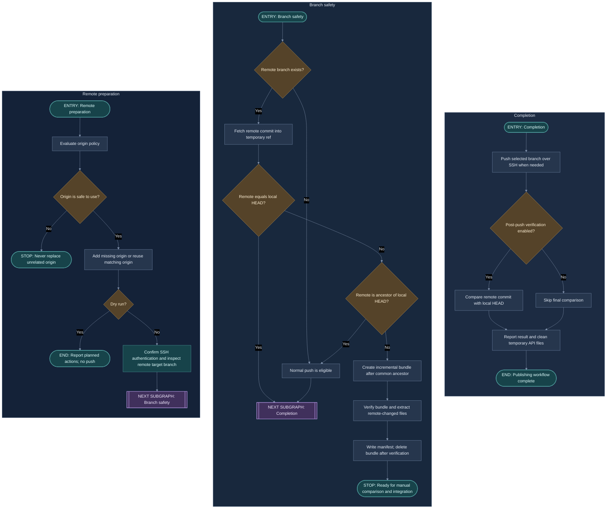

# Program Flow and Execution Map

This document presents GHPUtil's end-to-end execution path before the detailed component documentation. The diagrams use the empirically preferred Mermaid layout: the parent flowchart and each subgraph use `TB`, while subgraphs are declared in reverse order so the rendered groups appear in the intended left-to-right sequence. Steps inside each group are stacked vertically.

## Visual conventions

- **Stadium-shaped nodes** mark the entry to a subgraph or a terminal outcome.
- **Double-edged subroutine nodes** mark an explicit handoff to the next subgraph or flowchart. They are real nodes inside the preceding subgraph, not captions or external notes.
- **Diamonds** represent decisions.
- **Rounded process nodes** represent actions; colors distinguish ordinary processing, decisions, security/transport operations, and handoffs.
- No arrows are drawn between subgraphs. The handoff is made explicit by a final node in the current subgraph and a matching entry node in the next subgraph.

The diagrams use Mermaid's `base` theme with a coordinated dark palette. Colors are semantic and intentionally muted for readability.

## Stage A — Startup and project configuration

This stage resolves the installed utility, parses the command line, locates the project, and prepares its project-specific configuration. The `--help` and `--init` options can end execution before the publishing workflow begins.

**Execution sequence:** Invocation and bootstrap → Project configuration → Stage B's Local project checks. The `A9` handoff node names the next subgraph; `B0` marks its entry. After configuration is resolved, `B10` names the next flowchart and its first subgraph. Help, completed `--init`, declined configuration creation, or a non-interactive missing configuration can terminate the run without publishing.

## Stage B — Local validation and GitHub repository decision

This stage verifies the local project and identifies the target GitHub account and repository. Each group's checks proceed from top to bottom. The groups are declared in reverse order to produce the preferred visual order: Local project checks, GitHub API checks, then Repository decision.

**Execution sequence:** Stage A → Local project checks → GitHub API checks → Repository decision → Stage C's Remote preparation. `C5`, `D5`, and `E9` are explicit handoff nodes; the receiving subgraphs identify their entry points. The repository-decision branches either stop under the `stop` policy or continue to Stage C. A dry run records planned creation rather than creating the remote repository.

## Stage C — SSH, remote recovery, publication, and verification

Repository administration uses HTTPS and the PAT; Git transport uses SSH. Before a push, GHPUtil verifies the intended `origin`, confirms SSH authentication, and inspects the remote branch. It retrieves remote objects into a temporary ref before ancestry checks. If remote-only commits exist, it creates and verifies an incremental bundle, extracts only the remote-changed file versions into `GHPUtil-Remote/`, writes a manifest, deletes the bundle only after successful extraction, and stops for manual comparison. A normal push remains available when the remote is an ancestor of local HEAD. The groups are declared in reverse order to render as Remote preparation, Branch safety, and Completion.

**Execution sequence:** Stage B → Remote preparation → Branch safety → Completion. `F6` and `G7` explicitly identify the next subgraph, whose entry node is marked. The workflow ends at `H6`; the dry-run and safety-refusal branches terminate earlier. No inter-subgraph arrows are used.

**Terminal outcomes:** successful publication (with optional post-push verification), no push needed because the remote already matches local HEAD, remote recovery snapshot ready for manual integration, dry-run report, or a safe refusal. GHPUtil does not force-push, merge, rewrite history, stage files, or create commits.

## Reading the component documentation

After following the overall flow, use the documentation index to move into the details of configuration, authentication, Git inspection, GitHub repository management, and publishing behavior. The diagrams describe the orchestration path; the individual modules define the rules and safeguards applied at each step.
