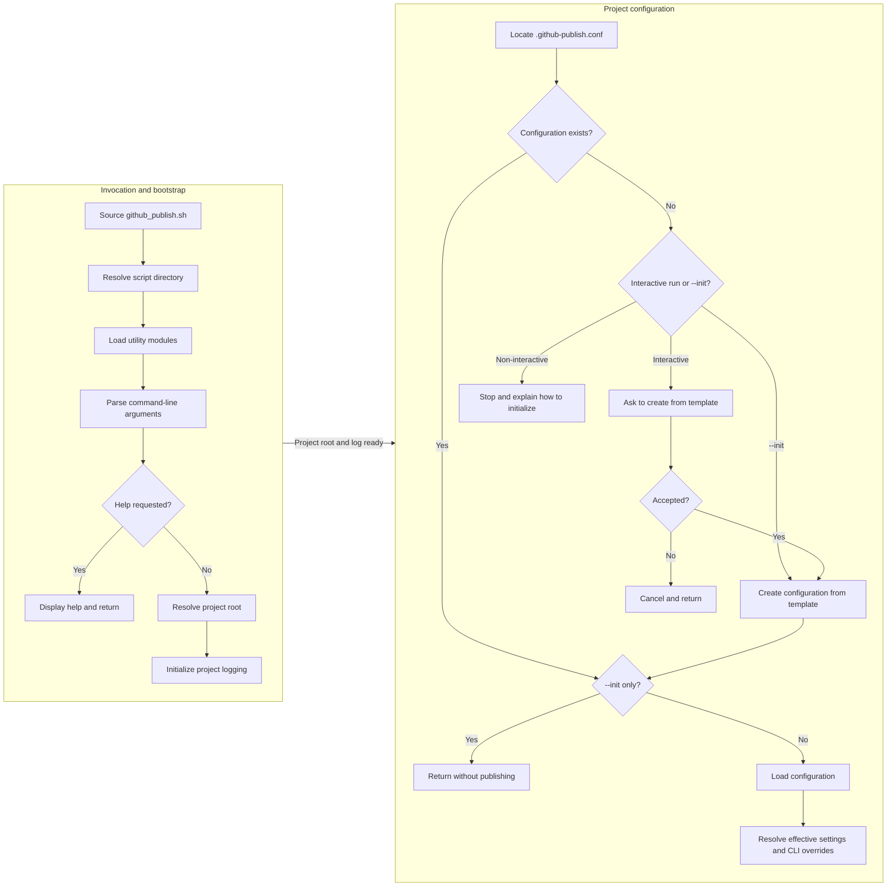
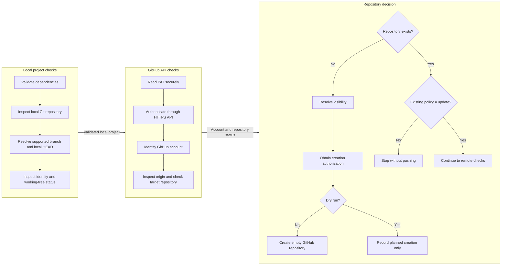
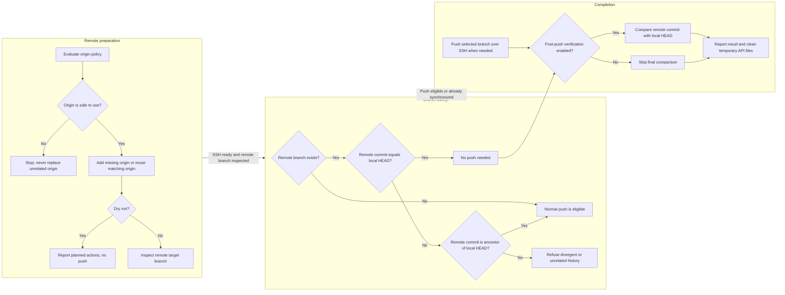

# Program Flow and Execution Map

This document presents GHPUtil's end-to-end execution path before the detailed component documentation. Each diagram uses a landscape layout: major process groups are arranged from left to right, while the steps inside each group are stacked vertically. Arrows between groups show the handoff to the next stage.

## Stage A — Startup and project configuration

This stage resolves the installed utility, parses the command line, locates the project, and prepares its project-specific configuration. The `--help` and `--init` options can end execution before the publishing workflow begins.

**Handoff to Stage B:** a resolved project root, initialized log, and effective project settings. If help is requested, initialization is complete, or configuration creation is declined, the workflow returns without publishing.

## Stage B — Local validation and GitHub repository decision

This stage verifies the local project and identifies the target GitHub account and repository. The process groups are columns; each group's checks proceed from top to bottom.

**Handoff to Stage C:** authenticated GitHub account, repository identity, resolved repository-existence policy, and—when needed—an empty remote repository. A normal run stops if an existing repository is governed by the `stop` policy.

## Stage C — SSH, branch safety, publication, and verification

Repository administration uses HTTPS and the PAT; Git transport uses SSH. Before a push, GHPUtil verifies the intended `origin`, confirms SSH authentication, and inspects the remote branch. It only performs a normal push when the history relationship is safe.

**Terminal outcomes:** successful publication (with optional post-push verification), no push needed because the remote already matches local HEAD, dry-run report, or a safe refusal. GHPUtil does not force-push, merge, rewrite history, stage files, or create commits.

## Reading the component documentation

After following the overall flow, use the documentation index to move into the details of configuration, authentication, Git inspection, GitHub repository management, and publishing behavior. The diagrams describe the orchestration path; the individual modules define the rules and safeguards applied at each step.
