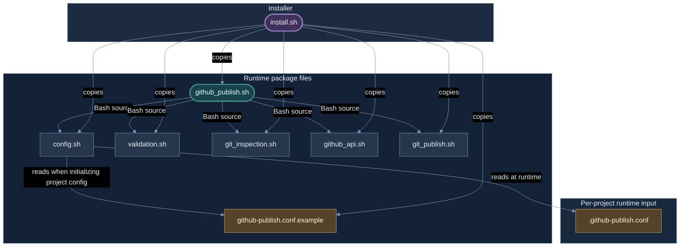

# Source File Dependency Graph

This module shows how files in the GHPUtil package relate to one another. It is separate from the function call graph: file dependencies describe how source and configuration files are loaded or used by the installer, while function-call edges describe runtime calls between individual functions.

## Dependency categories

- **Sources at runtime:** `github_publish.sh` loads the five implementation modules with Bash `source`.
- **Reads as a template:** `config.sh` reads `github-publish.conf.example` when initializing a project's `.github-publish.conf`.
- **Copies during installation:** `install.sh` copies the publisher, its modules, and the configuration template into the target installation directory.
- **Project input:** `.github-publish.conf` is created in the target project directory and read by `config.sh`. It is not a package source module.

The graph distinguishes these relationships with labeled arrows. It does not infer dependencies merely because a file is mentioned in documentation.

## Package file dependency graph

## What the graph tells us

### Runtime loading

`github_publish.sh` is the runtime entry script. Its `bootstrap()` function resolves the script directory, sources `config.sh`, `validation.sh`, `git_inspection.sh`, `github_api.sh`, and `git_publish.sh`, and then invokes `main()`.

The five sourced modules define functions in the current Bash process. They are not independent executables launched as child processes.

### Configuration template and project configuration

`config.sh` refers to `github-publish.conf.example` relative to the installed script directory. When the target project has no `.github-publish.conf`, `prepare_project_config()` can copy the template into that project. Later, `load_project_config()` reads the project-specific file.

The project configuration is runtime data, not a sourced Bash module. The template is a packaged file dependency, not an executable module.

### Installation

`install.sh` copies these seven package files:

- `github_publish.sh`
- `config.sh`
- `validation.sh`
- `git_inspection.sh`
- `github_api.sh`
- `git_publish.sh`
- `github-publish.conf.example`

It also creates the installation `logs/` directory and applies permissions. The installer does not copy the documentation directory as part of its script-defined installation loop.

## External runtime dependencies

The graph is limited to files in the GHPUtil package and its project configuration input. The scripts also rely on commands provided by the operating environment, including Bash, Git, curl, SSH, awk, sed, cksum, mktemp, realpath, tr, cp, chmod, ln, rm, date, head, and related standard utilities. Those are environment/tool dependencies rather than source-file dependencies within this package.

## Maintenance rule

Update this diagram whenever the `source` statements, installer copy list, or configuration-template handling changes. Update the function call graph separately when function definitions or call relationships change. The diagrams are derived documentation; the current source files remain authoritative.
