# Function Call Graph — Complete Vertical Rendering

This alternative keeps every function and relationship in one diagram. The parent graph is top-to-bottom, and each source-file group is also top-to-bottom. It is intended to reduce the extremely wide shape of the original diagram.

```mermaid
%%{init: {"theme":"base","themeVariables":{"darkMode":true,"background":"#0b1220","primaryColor":"#26364d","primaryTextColor":"#e6edf7","primaryBorderColor":"#7186a6","lineColor":"#8293ad","secondaryColor":"#1b2a40","tertiaryColor":"#172338","clusterBkg":"#172338","clusterBorder":"#526783","fontFamily":"Arial, sans-serif"}}}%%
flowchart TB
  subgraph M[github_publish.sh]
    direction TB
    bootstrap(["bootstrap#40;#41;"])
    main(["main#40;#41;"])
  end
  subgraph C[config.sh]
    direction TB
    usage["usage#40;#41;"]
    parse_arguments["parse_arguments#40;#41;"]
    prepare_project_config["prepare_project_config#40;#41;"]
    load_project_config["load_project_config#40;#41;"]
    resolve_effective_config["resolve_effective_config#40;#41;"]
    resolve_visibility["resolve_visibility#40;#41;"]
    confirm_repository_creation["confirm_repository_creation#40;#41;"]
  end
  subgraph V[validation.sh]
    direction TB
    die["die#40;#41;"]
    log["log#40;#41;"]
    run_step["run_step#40;#41;"]
    validate_enum["validate_enum#40;#41;"]
    resolve_project_root["resolve_project_root#40;#41;"]
    initialize_logging["initialize_logging#40;#41;"]
    validate_dependencies["validate_dependencies#40;#41;"]
  end
  subgraph G[git_inspection.sh]
    direction TB
    inspect_local_repository["inspect_local_repository#40;#41;"]
    inspect_origin_remote["inspect_origin_remote#40;#41;"]
    remote_matches_intended_repository["remote_matches_intended_repository#40;#41;"]
  end
  subgraph A[github_api.sh]
    direction TB
    load_github_token["load_github_token#40;#41;"]
    cleanup_api_temp["cleanup_api_temp#40;#41;"]
    api_request["api_request#40;#41;"]
    github_authenticate["github_authenticate#40;#41;"]
    check_github_repository["check_github_repository#40;#41;"]
    github_create_repository["github_create_repository#40;#41;"]
    api_error_message["api_error_message#40;#41;"]
  end
  subgraph P[git_publish.sh]
    direction TB
    configure_origin_remote["configure_origin_remote#40;#41;"]
    verify_ssh_authentication["verify_ssh_authentication#40;#41;"]
    publish_branch["publish_branch#40;#41;"]
    verify_publication["verify_publication#40;#41;"]
    report_dry_run["report_dry_run#40;#41;"]
    report_success["report_success#40;#41;"]
  end
  subgraph I[install.sh]
    direction TB
    install_main(["install_main#40;#41;"])
  end  bootstrap -->|direct call| main
  main -->|dispatches through run_step| run_step
  run_step -.->|dynamic target| parse_arguments
  run_step -.->|dynamic target| resolve_project_root
  run_step -.->|dynamic target| initialize_logging
  run_step -.->|dynamic target| prepare_project_config
  run_step -.->|dynamic target| load_project_config
  run_step -.->|dynamic target| resolve_effective_config
  run_step -.->|dynamic target| validate_dependencies
  run_step -.->|dynamic target| inspect_local_repository
  run_step -.->|dynamic target| load_github_token
  run_step -.->|dynamic target| github_authenticate
  run_step -.->|dynamic target| inspect_origin_remote
  run_step -.->|dynamic target| check_github_repository
  run_step -.->|dynamic target| resolve_visibility
  run_step -.->|dynamic target| confirm_repository_creation
  run_step -.->|dynamic target| github_create_repository
  run_step -.->|dynamic target| configure_origin_remote
  run_step -.->|dynamic target| verify_ssh_authentication
  run_step -.->|dynamic target| publish_branch
  run_step -.->|dynamic target| verify_publication
  run_step -->|failure cleanup| cleanup_api_temp
  main -->|direct call| usage
  main -->|direct call| log
  main -->|direct call| report_dry_run
  main -->|direct call| report_success
  main -->|direct call| cleanup_api_temp
  main -->|error path| die
  parse_arguments --> die
  prepare_project_config --> die
  prepare_project_config --> log
  load_project_config --> die
  load_project_config --> log
  resolve_effective_config --> validate_enum
  resolve_effective_config --> die
  resolve_effective_config --> log
  resolve_visibility --> validate_enum
  resolve_visibility --> die
  resolve_visibility --> log
  confirm_repository_creation --> die
  confirm_repository_creation --> log
  die --> log
  validate_enum --> die
  resolve_project_root --> die
  initialize_logging --> die
  validate_dependencies --> die
  inspect_local_repository --> die
  inspect_local_repository --> log
  inspect_origin_remote --> remote_matches_intended_repository
  inspect_origin_remote --> die
  inspect_origin_remote --> log
  load_github_token --> die
  api_request --> die
  github_authenticate --> api_request
  github_authenticate --> die
  check_github_repository --> api_request
  check_github_repository --> api_error_message
  check_github_repository --> die
  github_create_repository --> api_request
  github_create_repository --> api_error_message
  github_create_repository --> die
  github_create_repository --> log
  configure_origin_remote --> die
  configure_origin_remote --> log
  verify_ssh_authentication --> die
  verify_ssh_authentication --> log
  publish_branch --> die
  publish_branch --> log
  verify_publication --> die
  verify_publication --> log
  report_dry_run --> log
  report_success --> log
  classDef ordinary fill:#26364d,stroke:#7186a6,color:#e6edf7,stroke-width:1px;
  classDef entry fill:#17434a,stroke:#4e9b9c,color:#e2ffff,stroke-width:2px;
  classDef security fill:#17434a,stroke:#4e9b9c,color:#e2ffff,stroke-width:1px;
  classDef orchestration fill:#40305c,stroke:#a78bd4,color:#f2eaff,stroke-width:2px;
  class bootstrap,main,install_main entry;
  class run_step,cleanup_api_temp orchestration;
  class load_github_token,api_request,github_authenticate,check_github_repository,github_create_repository,verify_ssh_authentication security;
  class configure_origin_remote,publish_branch,verify_publication,report_dry_run,report_success,api_error_message,inspect_local_repository,inspect_origin_remote,remote_matches_intended_repository,die,log,validate_enum,resolve_project_root,initialize_logging,validate_dependencies,usage,parse_arguments,prepare_project_config,load_project_config,resolve_effective_config,resolve_visibility,confirm_repository_creation ordinary;
  style I fill:#142238,stroke:#526783,stroke-width:1px,color:#e6edf7
  style P fill:#17263b,stroke:#526783,stroke-width:1px,color:#e6edf7
  style A fill:#18283d,stroke:#526783,stroke-width:1px,color:#e6edf7
  style G fill:#142238,stroke:#526783,stroke-width:1px,color:#e6edf7
  style V fill:#18283d,stroke:#526783,stroke-width:1px,color:#e6edf7
  style C fill:#142238,stroke:#526783,stroke-width:1px,color:#e6edf7
  style M fill:#1c2b42,stroke:#526783,stroke-width:1px,color:#e6edf7
```

**What to evaluate:** whether the whole call structure remains legible without horizontal scrolling, and whether the cross-file arrows are still easy to follow.
