# Function Call Graph — Split Rendering

This alternative divides the same source-derived call graph into three diagrams. It trades a single overview for smaller, more readable views. Each diagram repeats the relevant handoff points so that relationships crossing a section boundary remain visible.

## A. Entry point and orchestration

```mermaid
%%{init: {"theme":"base","themeVariables":{"darkMode":true,"background":"#0b1220","primaryColor":"#26364d","primaryTextColor":"#e6edf7","primaryBorderColor":"#7186a6","lineColor":"#8293ad","secondaryColor":"#1b2a40","tertiaryColor":"#172338","clusterBkg":"#172338","clusterBorder":"#526783","fontFamily":"Arial, sans-serif"}}}%%
flowchart TB
  bootstrap(["bootstrap#40;#41;"]) --> main(["main#40;#41;"])
  main --> run_step["run_step#40;#41;"]
  run_step -.-> parse_arguments["parse_arguments#40;#41;"]
  run_step -.-> resolve_project_root["resolve_project_root#40;#41;"]
  run_step -.-> initialize_logging["initialize_logging#40;#41;"]
  run_step -.-> prepare_project_config["prepare_project_config#40;#41;"]
  run_step -.-> load_project_config["load_project_config#40;#41;"]
  run_step -.-> resolve_effective_config["resolve_effective_config#40;#41;"]
  run_step -.-> validate_dependencies["validate_dependencies#40;#41;"]
  run_step -.-> inspect_local_repository["inspect_local_repository#40;#41;"]
  run_step -.-> load_github_token["load_github_token#40;#41;"]
  run_step -.-> github_authenticate["github_authenticate#40;#41;"]
  run_step -.-> inspect_origin_remote["inspect_origin_remote#40;#41;"]
  run_step -.-> check_github_repository["check_github_repository#40;#41;"]
  run_step -.-> resolve_visibility["resolve_visibility#40;#41;"]
  run_step -.-> confirm_repository_creation["confirm_repository_creation#40;#41;"]
  run_step -.-> github_create_repository["github_create_repository#40;#41;"]
  run_step -.-> configure_origin_remote["configure_origin_remote#40;#41;"]
  run_step -.-> verify_ssh_authentication["verify_ssh_authentication#40;#41;"]
  run_step -.-> publish_branch["publish_branch#40;#41;"]
  run_step -.-> verify_publication["verify_publication#40;#41;"]
  run_step --> cleanup_api_temp["cleanup_api_temp#40;#41;"]
  main --> usage["usage#40;#41;"]
  main --> report_dry_run["report_dry_run#40;#41;"]
  main --> report_success["report_success#40;#41;"]
  main --> log["log#40;#41;"]
  main --> cleanup_api_temp
  main --> die["die#40;#41;"]
  classDef entry fill:#17434a,stroke:#4e9b9c,color:#e2ffff,stroke-width:2px;
  classDef orchestration fill:#40305c,stroke:#a78bd4,color:#f2eaff,stroke-width:2px;
  class bootstrap,main entry; class run_step,cleanup_api_temp orchestration;
```

Dashed arrows are dynamic targets passed through `run_step()`. The arrow to `cleanup_api_temp()` represents failure cleanup. Direct calls from `main()` are shown separately.

## B. Configuration, validation, and repository inspection

```mermaid
%%{init: {"theme":"base","themeVariables":{"darkMode":true,"background":"#0b1220","primaryColor":"#26364d","primaryTextColor":"#e6edf7","primaryBorderColor":"#7186a6","lineColor":"#8293ad","secondaryColor":"#1b2a40","tertiaryColor":"#172338","clusterBkg":"#172338","clusterBorder":"#526783","fontFamily":"Arial, sans-serif"}}}%%
flowchart TB
  subgraph C[config.sh]
    direction TB
    usage["usage#40;#41;"]
    parse_arguments["parse_arguments#40;#41;"]
    prepare_project_config["prepare_project_config#40;#41;"]
    load_project_config["load_project_config#40;#41;"]
    resolve_effective_config["resolve_effective_config#40;#41;"]
    resolve_visibility["resolve_visibility#40;#41;"]
    confirm_repository_creation["confirm_repository_creation#40;#41;"]
  end
  subgraph V[validation.sh]
    direction TB
    die["die#40;#41;"]
    log["log#40;#41;"]
    validate_enum["validate_enum#40;#41;"]
    resolve_project_root["resolve_project_root#40;#41;"]
    initialize_logging["initialize_logging#40;#41;"]
    validate_dependencies["validate_dependencies#40;#41;"]
  end
  subgraph G[git_inspection.sh]
    direction TB
    inspect_local_repository["inspect_local_repository#40;#41;"]
    inspect_origin_remote["inspect_origin_remote#40;#41;"]
    remote_matches_intended_repository["remote_matches_intended_repository#40;#41;"]
  end
  prepare_project_config --> die & log
  load_project_config --> die & log
  resolve_effective_config --> validate_enum & die & log
  resolve_visibility --> validate_enum & die & log
  confirm_repository_creation --> die & log
  parse_arguments --> die
  validate_enum --> die
  resolve_project_root --> die
  initialize_logging --> die
  validate_dependencies --> die
  inspect_local_repository --> die & log
  inspect_origin_remote --> remote_matches_intended_repository & die & log
  die --> log
  classDef ordinary fill:#26364d,stroke:#7186a6,color:#e6edf7,stroke-width:1px;
  classDef shared fill:#40305c,stroke:#a78bd4,color:#f2eaff,stroke-width:2px;
  class die,log shared;
```

The orchestration view above dispatches into these functions. The shared `die()` and `log()` services are included here because they account for many of the cross-module edges.

## C. GitHub API and publication

```mermaid
%%{init: {"theme":"base","themeVariables":{"darkMode":true,"background":"#0b1220","primaryColor":"#26364d","primaryTextColor":"#e6edf7","primaryBorderColor":"#7186a6","lineColor":"#8293ad","secondaryColor":"#1b2a40","tertiaryColor":"#172338","clusterBkg":"#172338","clusterBorder":"#526783","fontFamily":"Arial, sans-serif"}}}%%
flowchart TB
  subgraph A[github_api.sh]
    direction TB
    load_github_token["load_github_token#40;#41;"]
    cleanup_api_temp["cleanup_api_temp#40;#41;"]
    api_request["api_request#40;#41;"]
    github_authenticate["github_authenticate#40;#41;"]
    check_github_repository["check_github_repository#40;#41;"]
    github_create_repository["github_create_repository#40;#41;"]
    api_error_message["api_error_message#40;#41;"]
  end
  subgraph P[git_publish.sh]
    direction TB
    configure_origin_remote["configure_origin_remote#40;#41;"]
    verify_ssh_authentication["verify_ssh_authentication#40;#41;"]
    publish_branch["publish_branch#40;#41;"]
    verify_publication["verify_publication#40;#41;"]
    report_dry_run["report_dry_run#40;#41;"]
    report_success["report_success#40;#41;"]
  end
  load_github_token --> die["die#40;#41;"]
  api_request --> die
  github_authenticate --> api_request & die
  check_github_repository --> api_request & api_error_message & die
  github_create_repository --> api_request & api_error_message & die & log["log#40;#41;"]
  configure_origin_remote --> die & log
  verify_ssh_authentication --> die & log
  publish_branch --> die & log
  verify_publication --> die & log
  report_dry_run --> log
  report_success --> log
  classDef security fill:#17434a,stroke:#4e9b9c,color:#e2ffff,stroke-width:1px;
  class load_github_token,api_request,github_authenticate,check_github_repository,github_create_repository,verify_ssh_authentication security;
  classDef shared fill:#40305c,stroke:#a78bd4,color:#f2eaff,stroke-width:2px;
  class die,log shared;
```

The entry/orchestration view shows how `main()` dispatches to the API and publishing functions. This view concentrates on the calls within those modules and their shared error/reporting services. `install_main()` remains a separate installer entry point and is intentionally omitted from the runtime split views.

**What to evaluate:** whether the smaller diagrams are substantially easier to read, and whether the repeated handoff explanation is sufficient without a single massive graph.
