# Function Call Graph — Responsibility-Layer Rendering

This alternative groups functions by their role in the publishing process rather than by source file. It keeps one diagram but separates orchestration, preparation, remote operations, and shared services into visual layers. The source file for each function is shown in the adjacent key.

```mermaid
%%{init: {"theme":"base","themeVariables":{"darkMode":true,"background":"#0b1220","primaryColor":"#26364d","primaryTextColor":"#e6edf7","primaryBorderColor":"#7186a6","lineColor":"#8293ad","secondaryColor":"#1b2a40","tertiaryColor":"#172338","clusterBkg":"#172338","clusterBorder":"#526783","fontFamily":"Arial, sans-serif"}}}%%
flowchart TB
  subgraph L1[Entry and orchestration]
    direction LR
    bootstrap(["bootstrap#40;#41;"]) --> main(["main#40;#41;"]) --> run_step["run_step#40;#41;"]
    install_main(["install_main#40;#41;"])
  end
  subgraph L2[Configuration and preparation]
    direction LR
    parse_arguments["parse_arguments#40;#41;"]
    prepare_project_config["prepare_project_config#40;#41;"]
    load_project_config["load_project_config#40;#41;"]
    resolve_effective_config["resolve_effective_config#40;#41;"]
    resolve_visibility["resolve_visibility#40;#41;"]
    confirm_repository_creation["confirm_repository_creation#40;#41;"]
    resolve_project_root["resolve_project_root#40;#41;"]
    initialize_logging["initialize_logging#40;#41;"]
    validate_dependencies["validate_dependencies#40;#41;"]
    validate_enum["validate_enum#40;#41;"]
  end
  subgraph L3[Repository, API, and publication operations]
    direction LR
    inspect_local_repository["inspect_local_repository#40;#41;"]
    inspect_origin_remote["inspect_origin_remote#40;#41;"]
    remote_matches_intended_repository["remote_matches_intended_repository#40;#41;"]
    load_github_token["load_github_token#40;#41;"]
    github_authenticate["github_authenticate#40;#41;"]
    api_request["api_request#40;#41;"]
    check_github_repository["check_github_repository#40;#41;"]
    github_create_repository["github_create_repository#40;#41;"]
    configure_origin_remote["configure_origin_remote#40;#41;"]
    verify_ssh_authentication["verify_ssh_authentication#40;#41;"]
    publish_branch["publish_branch#40;#41;"]
    verify_publication["verify_publication#40;#41;"]
    api_error_message["api_error_message#40;#41;"]
  end
  subgraph L4[Shared error handling and reporting]
    direction LR
    die["die#40;#41;"] --> log["log#40;#41;"]
    cleanup_api_temp["cleanup_api_temp#40;#41;"]
    usage["usage#40;#41;"]
    report_dry_run["report_dry_run#40;#41;"]
    report_success["report_success#40;#41;"]
  end
  main --> run_step
  run_step -.-> parse_arguments & resolve_project_root & initialize_logging & prepare_project_config & load_project_config & resolve_effective_config & validate_dependencies & inspect_local_repository & load_github_token & github_authenticate & inspect_origin_remote & check_github_repository & resolve_visibility & confirm_repository_creation & github_create_repository & configure_origin_remote & verify_ssh_authentication & publish_branch & verify_publication
  run_step --> cleanup_api_temp
  main --> usage & report_dry_run & report_success & die & log & cleanup_api_temp
  resolve_effective_config --> validate_enum
  resolve_visibility --> validate_enum
  prepare_project_config --> die & log
  load_project_config --> die & log
  resolve_effective_config --> die & log
  resolve_visibility --> die & log
  confirm_repository_creation --> die & log
  validate_enum --> die
  resolve_project_root --> die
  initialize_logging --> die
  validate_dependencies --> die
  inspect_local_repository --> die & log
  inspect_origin_remote --> die & log
  github_authenticate --> die
  check_github_repository --> api_error_message & die
  github_create_repository --> api_error_message & die & log
  api_request --> die
  configure_origin_remote --> die & log
  verify_ssh_authentication --> die & log
  publish_branch --> die & log
  verify_publication --> die & log
  report_dry_run --> log
  report_success --> log
  classDef ordinary fill:#26364d,stroke:#7186a6,color:#e6edf7,stroke-width:1px;
  classDef entry fill:#17434a,stroke:#4e9b9c,color:#e2ffff,stroke-width:2px;
  classDef security fill:#17434a,stroke:#4e9b9c,color:#e2ffff,stroke-width:1px;
  classDef orchestration fill:#40305c,stroke:#a78bd4,color:#f2eaff,stroke-width:2px;
  class bootstrap,main,install_main entry;
  class run_step,cleanup_api_temp orchestration;
  class load_github_token,api_request,github_authenticate,check_github_repository,github_create_repository,verify_ssh_authentication security;
  class parse_arguments,prepare_project_config,load_project_config,resolve_effective_config,resolve_visibility,confirm_repository_creation,resolve_project_root,initialize_logging,validate_dependencies,validate_enum,inspect_local_repository,inspect_origin_remote,remote_matches_intended_repository,configure_origin_remote,publish_branch,verify_publication,api_error_message,die,log,usage,report_dry_run,report_success ordinary;
```

## Function-to-file key

- `github_publish.sh`: `bootstrap()`, `main()`
- `config.sh`: `usage()`, `parse_arguments()`, `prepare_project_config()`, `load_project_config()`, `resolve_effective_config()`, `resolve_visibility()`, `confirm_repository_creation()`
- `validation.sh`: `die()`, `log()`, `run_step()`, `validate_enum()`, `resolve_project_root()`, `initialize_logging()`, `validate_dependencies()`
- `git_inspection.sh`: `inspect_local_repository()`, `inspect_origin_remote()`, `remote_matches_intended_repository()`
- `github_api.sh`: `load_github_token()`, `cleanup_api_temp()`, `api_request()`, `github_authenticate()`, `check_github_repository()`, `github_create_repository()`, `api_error_message()`
- `git_publish.sh`: `configure_origin_remote()`, `verify_ssh_authentication()`, `publish_branch()`, `verify_publication()`, `report_dry_run()`, `report_success()`
- `install.sh`: `install_main()`

**What to evaluate:** whether grouping by responsibility makes the execution story easier to understand, or whether source-file grouping is more useful for maintenance. This rendering intentionally favors process layers over a strict file map.
